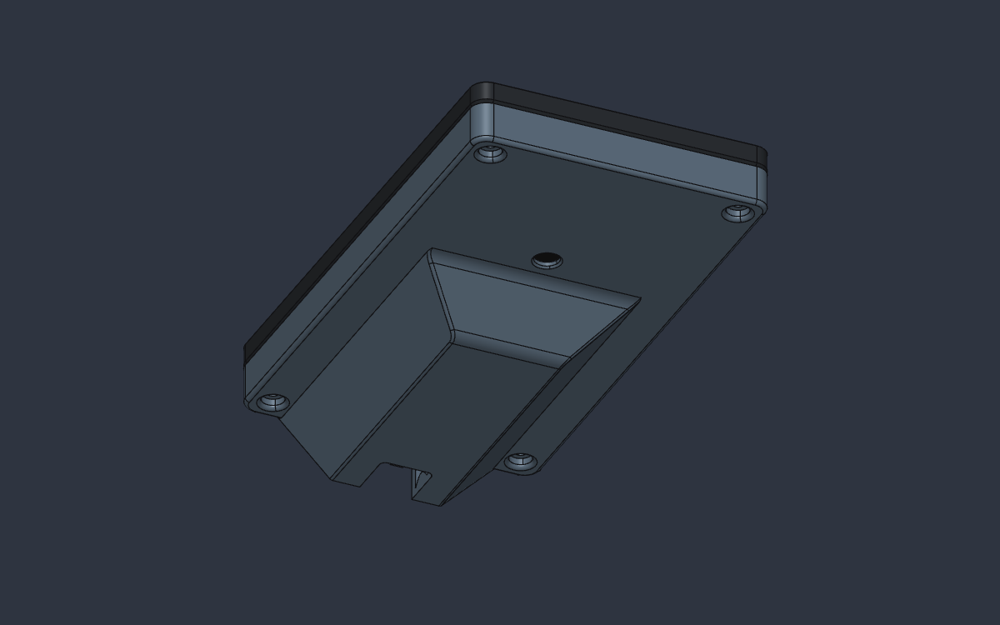
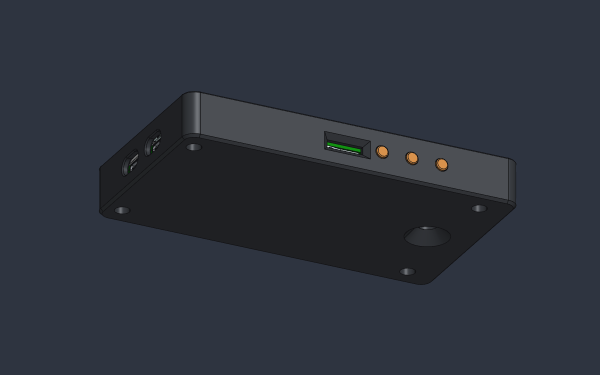

# P4Enclosures

3D-printable enclosures for Kern devices built on **ESP32-P4** boards, modelled in
[SolidCraft](https://github.com/bherbruck/solidcraft).

Each enclosure has its own folder, named after Kern's designation for the device, with its designs,
print-ready exports and a README describing the part.

## Enclosures

| Folder | Board | Enclosure | Status |
|---|---|---|---|
| [`p4_pico/`](p4_pico/README.md) | ESP32-P4-Pico with a 5" DSI touch display (050-DSI-TOUCH-A) | Back shell screwed to the display's corner standoffs; the board sits in a keel | Printed and tested |
| [`wave_5/`](wave_5/README.md) | Waveshare ESP32-P4-WIFI6-Touch-LCD-5 | One-piece case: glass in a rim pocket, battery bay, camera holder, three button plungers | Case and buttons modelled and exported; not print-tested yet |

| `p4_pico` | `wave_5` |
|---|---|
|  |  |
| Back shell on the display: keel, camera window, USB-C and microSD slot | Case: USB-C ports, microSD slot, button plungers, camera cone |

## Layout

Every enclosure folder follows the same pattern:

| Path | What it is |
|---|---|
| `.sc` files in the repository | The printed parts, fully parametric, plus any simplified models of our own |
| `exports/` | Print-ready STL and 3MF (plus STEP where useful) |
| `images/` | Renders of the assembly |
| `<name>_enclosure.sc` | Local only. Assembly: the board, display and printed parts in place |
| Board model `.sc` | Local only. The vendor's board STEP imported into SolidCraft |
| `references/` | Local only. Vendor drawings and STEP files |

Local-only files contain vendor models, so git ignores them (see [License](#license)). Each folder's
README says how its board model is built from the vendor STEP and placed in the assembly. Assemblies
link their parts by relative path, so keep each folder's `.sc` files together.

## Opening the designs

Each folder's README says which file to open. After saving a part, run **Update Links** in its
assembly to bring the change in.

Shared conventions:

- Units are millimetres.
- Each enclosure has one world frame for all its files: the display centred at the origin, +Z toward
  the viewer, the USB-C end at +X. Where exactly the origin sits (the display's back face or the
  glass front) is given in each folder's README.
- Printed parts are driven by named user parameters (Parameters table, each with a comment). Prefer
  changing those to editing feature dialogs.

## Adding an enclosure

Create a new folder named after the device's Kern designation, as `p4_pico/` and `wave_5/` are. Give
it the same layout, model it in its own world frame, and add a README plus a row in the table above.
Put vendor files in its `references/` folder, which git ignores, and add every design that embeds a
vendor STEP (the board model and the assembly) to `.gitignore`.

## License

MIT, see [LICENSE](LICENSE). It covers this project's own files. Vendor drawings and board models
are not in the repository: `references/` and the designs that embed a vendor STEP (the board models
and the assemblies) are kept locally.
